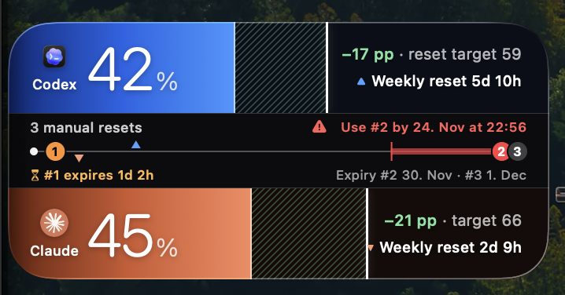

# Codex & Claude Usage Widget



Native macOS menu bar app and desktop WidgetKit widget for the signed-in Codex and Claude Code accounts on this Mac. Supports small, medium, and large widgets, percentage used, reset times, remaining Codex reset credits, their next expiry countdown, normal-reset countdowns, model-specific Claude windows, and stale-reading indicators.

## Install the app

Download `Usage-Widget-macOS.zip` from [Releases](https://github.com/JanLunge/codex-claude-usage-widget/releases/latest), unzip, and move **Usage Widget.app** to `~/Applications`. Requires macOS 14+ and signed-in Codex CLI / Claude Code accounts. The release supports Apple silicon and Intel Macs.

This is an ad hoc signed, unnotarized build. macOS may block the first launch; use System Settings → Privacy & Security → Open Anyway if you trust this build, or build from source below. The usage collector also requires `/usr/bin/python3` from Apple developer tools (`xcode-select --install`).

Launch the app, then right-click the desktop → **Edit Widgets** → **Usage Widget**. Keep the app running to refresh usage.

## Build and run

Requires macOS 14+, full Xcode (selected with `xcode-select`), XcodeGen, and `/usr/bin/python3`. Install XcodeGen with `brew install xcodegen`. Install and sign in to the Codex CLI and Claude Code before launching the app. No Python packages are required.

Clone this repository, then run:

```sh
./Scripts/build.sh
open "build/Build/Products/Release/Usage Widget.app"
```

For a stable installation, copy `Usage Widget.app` to `~/Applications`, launch it, then right-click the desktop → **Edit Widgets** → **Usage Widget**. Keep the menu bar app running for automatic refresh every five minutes. Optional **Open at login** keeps it available after restarting. Clicking the widget opens the dashboard. macOS schedules widget redraws, so desktop updates can lag the app.

## Sign-ins and privacy

- Codex: calls the installed Codex CLI's documented `account/rateLimits/read` app-server method. The CLI manages its own authentication; this app never opens Codex's authentication store.
- Claude Code: uses its existing Keychain entry (`Claude Code-credentials`) or local `.credentials.json` in memory to make a GET request to `https://api.anthropic.com/api/oauth/usage`. No credential is displayed, logged, copied to the widget cache, or passed as a process argument. Requests reject redirects. This is an internal Claude endpoint and may change.
- The widget extension has no credentials or network access. Its protected container cache contains only provider names, window labels, percentages, reset times, reset-credit counts and expiry dates, timestamps, and fixed status messages. File permissions are owner-only.
- No analytics, external storage, inference requests, or credential rotation. Claude Code itself must renew an expired sign-in. Account limits can include activity outside this device; these are subscription usage meters, not device-only token totals.
- Failed refreshes retain the last successful readings and mark them stale. Missing usage is shown as unavailable, never as zero. Manual refresh has a one-minute minimum interval. Reset-credit counts come from Codex’s authoritative `availableCount`; if the server returns only some credit details, the earliest returned expiry is labeled **Listed expiry**. If no expiry details are available, the UI says so. Claude does not report reset credits. The widget never consumes a reset credit.

If Claude is unavailable, run `claude auth status`, then sign in through Claude Code. If Codex is unavailable, open Codex or run `codex login` with your ChatGPT account.

If Claude Code reports logged in but an older widget says sign-in is unavailable, update to v0.1.1 or later. The reader accepts both plain JSON and hex-encoded JSON returned by macOS Keychain's `security` command. Quit Usage Widget before replacing the app, then reopen and refresh it. If it still fails, the app distinguishes unreadable credentials, undecodable credentials, and credentials without an OAuth token. API-key or third-party-provider sign-ins do not supply the Claude subscription OAuth token this widget needs.

The build script uses ad hoc signing for local builds. macOS cannot authorize a provisioned App Group for an ad hoc signature, so the containing app publishes the usage-only cache to `~/Library/Containers/com.janlunge.usagewidget.widget/Data/Library/Application Support/UsageWidget/usage.json`. The widget reads its own sandbox Application Support directory. Its sandbox remains enabled, with no network or credential access. Old usage readings migrate from the earlier group cache when updating. For distribution, use an Apple developer identity; a registered App Group is the conventional sharing mechanism for fully signed builds. Build output is under `build/` and ignored by Git.

## Validation

```sh
/usr/bin/python3 -m unittest discover -s Tests -v
swiftc -module-cache-path build/ModuleCache Shared/UsageSnapshot.swift Tests/SnapshotChecks.swift -o build/snapshot-checks
build/snapshot-checks
/usr/bin/python3 Scripts/usage.py
```

The final command outputs only sanitized usage/status JSON. Snapshot checks verify stale-reading preservation and date formats. Tests cover provider bucket selection, null values, clamping, reset parsing, output allowlisting, exception redaction, and redirect refusal.

References: [Codex app server](https://developers.openai.com/codex/app-server), [WidgetKit](https://developer.apple.com/documentation/widgetkit), [Claude endpoint issue](https://github.com/anthropics/claude-code/issues/31021).

## Widget diagnostics

Weekly usage compares consumption with elapsed time in each provider's own seven-day reset cycle. When usable Codex reset credits expire before the weekly reset, their expiry is highlighted with **Use before**, and the usage target uses the interval from the weekly cycle start to that earlier deadline. Otherwise, the target uses the normal weekly reset. A thin white marker shows the target percentage for now; ↑ means ahead of usage pace (use less), ↓ means behind pace (room to use more), and a dot means within one percentage point of the target. Arrow values show the difference in percentage points. The small widget prioritizes weekly usage for both accounts. Missing, expired, or invalid reset times hide the pace indicator until a valid reading is available; stale readings keep their existing warning.

Cache reads log only success counts or filesystem error codes under subsystem `com.janlunge.usagewidget`, category `cache`. No credentials or response bodies are logged. An empty-cache message on the desktop can be diagnosed separately from live account access in the containing app.

Widget layouts use blue for Codex and warm orange for Claude. The medium (2×1) widget uses the Horizon design: two equal-height, full-width gradient usage bands around a shared date-scaled timeline. Hatching spans the gap between usage and its white target marker (green for room to use more, amber for over target). The timeline plots weekly resets as provider-colored triangles, numbered credit expiries, and a red suggested-use deadline. It stacks Codex usage with manual-reset count and expiry, followed by Claude's usage windows. Every reported usage window has a full-width background progress fill, a percentage, and its normal-reset countdown. **Resets in** counts down to the normal usage-window reset; **Expires in** counts down to the next reset-credit expiry. Countdown text updates through SwiftUI’s dynamic date rendering. The small widget shows weekly usage in each account heading with a target marker and pace indicator; the large widget displays separate meters and reset times.

When later Codex credits expire too close together to leave seven days between uses, a red warning identifies the affected credit by expiry order and suggests when to use it (one-hour buffer). It checks every listed expiry, retaining duplicate dates, and counts backward seven days per subsequent credit. A conflict between later credits is flagged in advance, even if the first credit can still wait until its usual deadline. If that schedule is already impossible, it suggests starting now and warns that the next reset has less than seven days. Partial expiry lists are identified as listed data. The blue and orange usage areas retain equal heights when this warning appears.

## Source layout

- `App/`: menu bar app, dashboard, and refresh scheduling.
- `Widget/`: WidgetKit desktop extension.
- `Shared/`: usage models, layouts, and bundled provider artwork.
- `Scripts/usage.py`: provider usage collection with Python standard library only.
- `Scripts/build.sh`: generate the Xcode project, build, and ad hoc sign.
- `Tests/`: provider parsing and snapshot checks.

The generated Xcode project is included; `project.yml` is the source of truth. The app is a local utility and is not affiliated with OpenAI or Anthropic. See [artwork credits](Shared/Resources/README.md).
